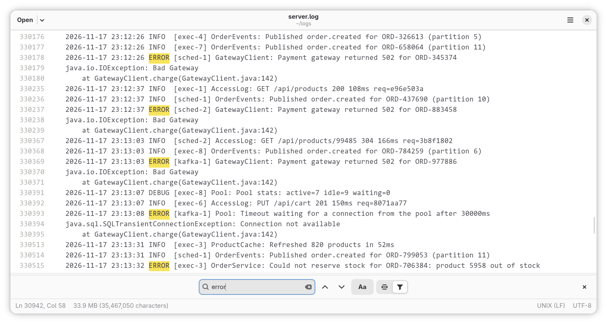

## Neatpad

[](https://github.com/strobejb/Neatpad/actions/workflows/build.yml)

Neatpad is a lightweight text editor for big text and log files: a Notepad
replacement for Windows, and now a GNOME app for Linux too.

It began as the example program for the tutorial series
[Design and Implementation of a Win32 Text Editor](https://www.catch22.net/tuts/neatpad)
on catch22.net, and has grown from there into a full editor. All the source is
here, to read, borrow from or build on.



### What it's good at

- **Huge files.** Open text and log files, data dumps and other huge files in moments, even
  several gigabytes long. Neatpad only reads what's on screen, so scrolling,
  searching and editing stay quick however large the file is.
- **Tailing logs.** **Follow File** shows new lines as they're written to a log,
  like `tail -f`. And if another program changes or deletes the file you have
  open, Neatpad tells you and offers to reload it.
- **Digging through logs.** **Filter** hides everything except the lines that
  match, with a few lines round them if you like. Or highlight every match as you
  type, and find and replace as usual.
- **Never losing work.** Unsaved changes are kept as you type. If Neatpad or your
  computer stops unexpectedly, they're waiting for you next time. Close a window
  with changes still unsaved and they come back when you open it again.
- **Any text file.** UTF-8, UTF-16, UTF-32 and Latin-1, with Windows, Unix or Mac
  line endings, all kept as the file had them. Save in another encoding, or
  tidy mixed line endings, whenever you want.
- **Helpful margins.** Line numbers, changed lines marked as you edit, the current
  line highlighted and a marker for lines that run too long.

### On Windows and on Linux

Both versions share the same editing engine, so they behave the same way, but
each one looks and feels at home on its own desktop.

- **Windows:** a small, classic Win32 program. No installer: download
  `Neatpad.exe` and run it.
- **Linux:** a GNOME app built with GTK 4 and libadwaita, with light and dark
  styles, your accent colour and a choice of colour palettes.

### Getting Neatpad

**Windows:** download the latest `Neatpad.exe` from the
[Releases](https://github.com/strobejb/Neatpad/releases) page.

**Linux:** a Flatpak on Flathub is on its way. Until then, build it yourself
(below). It takes a minute or two.

### Building it yourself

**Windows:** open `Neatpad.sln` in Visual Studio 2022 and build.

**Linux:** install a compiler, CMake, GTK 4 and libadwaita, then build:

```
# Fedora
sudo dnf install gcc-c++ cmake gtk4-devel libadwaita-devel

# Ubuntu and Debian
sudo apt install build-essential cmake libgtk-4-dev libadwaita-1-dev

cmake -S . -B build -DCMAKE_BUILD_TYPE=Release
cmake --build build
build/neatpad
```

To add it to your app grid, install it for yourself:

```
cmake --install build --prefix ~/.local
```

Or build and install it as a Flatpak (needs `flatpak-builder` and Flathub):

```
flatpak-builder --user --install --install-deps-from=flathub --force-clean \
    --state-dir=build/flatpak-state build/flatpak src/Neatpad/gtk/net.catch22.Neatpad.yml
flatpak run net.catch22.Neatpad
```

### The tutorials

The [Neatpad tutorial series](https://www.catch22.net/tuts/neatpad) walks through
how a text editor like this is put together, from first principles like drawing text, scrolling, mouse and keyboard input, all the through to advanced data structures for storing and editing text efficiently.

The code has moved on since many of the tutorials were written, so each part's
code is kept in the repository as it was, tagged `tutorial/part-01`,
`tutorial/part-02` and so on. Check out a tag to follow along with that part:

```
git checkout tutorial/part-07
```

### Licence

Written by J Brown, 2005-2026.

Released under the MIT License. See LICENCE.TXT.
